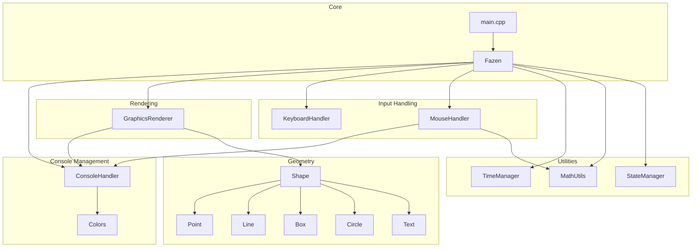

# Fazen2d
# ASCII & UNICODE Graphics Library made for and using C++ Windows 

# Fazen2d Engine Documentation

## Overview

Fazen2d is a lightweight ASCII & Unicode graphics library for Windows consoles. It provides basic **geometry primitives**, **console rendering**, **input handling**, **state management**, and **timing services**. Users can draw shapes (points, lines, boxes, circles, text), handle keyboard and mouse events, and run a continuous render loop in a structured framework.

This engine fits into applications that require simple graphical output without external libraries beyond the Windows API. It centralizes console setup, buffer management, and coordinate transformations to simplify 2D console graphics development.

## Architecture Overview



## Component Structure

### Geometry Module

#### Shape (`include/headers/Shape.h`)
The **Shape** class defines a common interface for all drawable primitives. It enforces:
- A **pure virtual** `draw()` method.
- A **pure virtual** `translate(float dx, float dy)` method.
- A **virtual destructor** for safe polymorphic cleanup.

```cpp
class Shape {
public:
    virtual void draw() = 0;
    virtual void translate(float dx, float dy) = 0;
    virtual ~Shape() = default;
};
```


#### Point (`include/headers/Point.h` / `include/Point.cpp`)
Represents a single console cell at `(x, y)` with a character and color.
- **Properties**: `x`, `y`, `color`, `character`
- **Key Methods**:
  - `draw()` writes the character into the console buffer.
  - `translate(dx, dy)` moves the point within console bounds.

```cpp
explicit Point(float x, float y, short color, short character = 0x2588);
void draw() override;
void translate(float dx, float dy) override;
```


#### Line (`include/headers/Line.h` / `include/Line.cpp`)
Draws a Bresenham line between two points.
- **Properties**: `x1, y1, x2, y2, color, character`
- **Key Methods**:
  - `draw()` implements Bresenham’s algorithm.
  - `translate(dx, dy)` shifts both endpoints.

```cpp
Line(float x1, float y1, float x2, float y2, short color, short character = 0x2588);
void draw() override;
void translate(float dx, float dy) override;
```


#### Box (`include/headers/Box.h` / `include/Box.cpp`)
Renders a filled rectangle by drawing multiple points.
- **Properties**: `x, y, width, height, color, character`
- **Key Methods**:
  - `draw()` loops over width/height to place points.
  - `translate(dx, dy)` moves the box if within console bounds.

```cpp
explicit Box(float x, float y, float width, float height, short color, short character = 0x2588);
void draw() override;
void translate(float dx, float dy) override;
```


#### Circle (`include/headers/Circle.h` / `include/Circle.cpp`)
Draws a filled circle by checking each cell within a bounding square.
- **Properties**: `xc, yc, radius, color, character`
- **Key Methods**:
  - `draw()` uses the distance formula for each cell.
  - `translate(dx, dy)` shifts center within valid range.

```cpp
explicit Circle(float xc, float yc, float radius, short color, short character = 0x2588);
void draw() override;
void translate(float dx, float dy) override;
```


#### Text (`include/headers/Text.h` / `include/Text.cpp`)
Renders a Unicode string at a given location.
- **Properties**: `x, y, wstring value, color`
- **Key Methods**:
  - `draw()` writes each wide character into the buffer.
  - `setValue` overloads accept `wstring` or `int`.

```cpp
Text(float x, float y, wstring s, short color);
void draw() override;
```


---

### Rendering Module

#### Colors (`include/headers/Colors.h` / `include/Colors.cpp`)
Defines console color constants and a **Color** utility class.
- **Enum** `ConsoleColor` maps to Windows attributes.
- **Class** `Color` holds `fgColor`, `bgColor`, and computes combined `value`.

```cpp
enum ConsoleColor { redF = FOREGROUND_RED, greenF = FOREGROUND_GREEN, /*…*/ };
class Color {
  short fgColor, bgColor, value;
  // setters/getters
};
```


#### GraphicsRenderer (`include/headers/GraphicsRenderer.h` / `include/GraphicsRenderer.cpp`)
Handles console buffer display and draws shapes.
- **Methods**:
  - `background(short col)` clears buffer with a color.
  - `draw(Shape &s)` invokes `s.draw()`.
  - `display()` writes buffer to the console via `WriteConsoleOutputW`.

```cpp
void background(short col);
void draw(Shape& s);
void display();
```


---

### Input Handling

#### KeyboardHandler (`include/headers/KeyboardHandler.h` / `include/KeyboardHandler.cpp`)
Wraps Windows key state functions.
- **Methods**:
  - `IsKeyPressed(int keyCode)`
  - `IsKeyReleased(int keyCode)`
  - `CheckForUserExit()` checks `VK_ESCAPE`.

```cpp
bool IsKeyPressed(int keyCode);
bool CheckForUserExit();
```


#### MouseHandler (`include/headers/MouseHandler.h` / `include/MouseHandler.cpp`)
Tracks mouse position and click states.
- **Properties**: `leftButtonPressed`, `rightButtonPressed`
- **Methods**:
  - `GetMouseX()`, `GetMouseY()` map screen to console coords.
  - `UpdateMouseState()`, `IsLeftMousePressed()`, `IsLeftMouseClicked()`, etc.

```cpp
float GetMouseX();
float GetMouseY();
void UpdateMouseState();
bool IsLeftMouseClicked();
```


---

### State & Timing

#### StateManager (`include/headers/StateManager.h` / `include/StateManager.cpp`)
Maintains a global **center** offset for coordinate translation.
- **Methods**:
  - `saveState()` / `restoreState()` to snapshot/restore center.
  - `setCenter(x, y)`, `translateCoordinates(x&, y&)`.

```cpp
static void setCenter(float x, float y);
static void translateCoordinates(float& x, float& y);
```


#### TimeManager (`include/headers/TimeManager.h` / `include/TimeManager.cpp`)
Measures frame-to-frame elapsed time.
- **Methods**:
  - `Reset()` resets the internal clock.
  - `GetElapsedTime()` returns seconds since last call.

```cpp
void Reset();
float GetElapsedTime();
```


#### MathUtils (`include/headers/MathUtils.h` / `include/MathUtils.cpp`)
Utility for numeric transformations.
- **Constants**: `static constexpr double pi`
- **Methods**:
  - `Map(value, x1, x2, y1, y2)` scales a value linearly between ranges.

```cpp
static float Map(float value, float x1, float x2, float y1, float y2);
```


---

### Console Management

#### ConsoleHandler (`include/headers/ConsoleHandler.h` / `include/ConsoleHandler.cpp`)
Sets up and manages a 2D console buffer.
- **Static Properties**: window handles, buffers, dimensions.
- **Constructor** configures font, buffer size, input modes.
- **Methods** expose buffer pointers, console size, cursor position.

```cpp
ConsoleHandler(int s_width, int s_height);
static CHAR_INFO* GetBuffScreen();
static int GetConsoleWidth();
static int GetConsoleHeight();
```


---

### Core

#### Fazen (`include/headers/Fazen.h` / `include/Fazen.cpp`)
Aggregates all subsystems:
- **Members**: `console`, `graphics`, `keyboardHandler`, `mouseHandler`, `timer`
- **Constructor** initializes `ConsoleHandler`.

```cpp
Fazen(int s_width, int s_height);
```


#### Main (`main.cpp`)
Entry point demonstrating the engine loop:
1. Instantiate `Fazen game(100, 100)`.
2. Clear background, draw shapes, translate them.
3. `game.graphics.display()`, exit on `ESC`.

```cpp
while (true) {
  game.graphics.background(whiteB);
  game.graphics.draw(b);
  // ...
  if (game.keyboardHandler.CheckForUserExit()) break;
}
```


#### Build (`Makefile`)
Compiles all `.cpp` under `include/` and `main.cpp` with `g++ -std=c++11`.
```bash
CC = g++
CFLAGS = -std=c++11
SRC_DIR = include
# ...
all: a
```


## Key Classes Reference

| Class              | Location                                | Responsibility                                     |
|--------------------|-----------------------------------------|----------------------------------------------------|
| Shape              | include/headers/Shape.h                 | Base interface for all drawable shapes             |
| Point              | include/headers/Point.h                 | Represents a single console cell                   |
| Line               | include/headers/Line.h                  | Draws lines using Bresenham’s algorithm            |
| Box                | include/headers/Box.h                   | Renders filled rectangles                          |
| Circle             | include/headers/Circle.h                | Renders filled circles                             |
| Text               | include/headers/Text.h                  | Draws wide-character strings                       |
| Colors / Color     | include/headers/Colors.h                | Defines color constants and utility class          |
| GraphicsRenderer   | include/headers/GraphicsRenderer.h      | Manages buffer clearing and shape rendering        |
| ConsoleHandler     | include/headers/ConsoleHandler.h        | Sets up and provides access to the console buffer  |
| KeyboardHandler    | include/headers/KeyboardHandler.h       | Wraps keyboard state queries                       |
| MouseHandler       | include/headers/MouseHandler.h          | Tracks mouse position and click states             |
| StateManager       | include/headers/StateManager.h          | Global coordinate offset manager                   |
| TimeManager        | include/headers/TimeManager.h           | Frame timing calculations                          |
| MathUtils          | include/headers/MathUtils.h             | Numeric mapping and constants                      |
| Fazen              | include/headers/Fazen.h                 | Aggregates all subsystems into one engine object   |
| Main               | main.cpp                                | Demonstrates engine initialization and loop        |
| Build              | Makefile                                | Compilation instructions                           |


