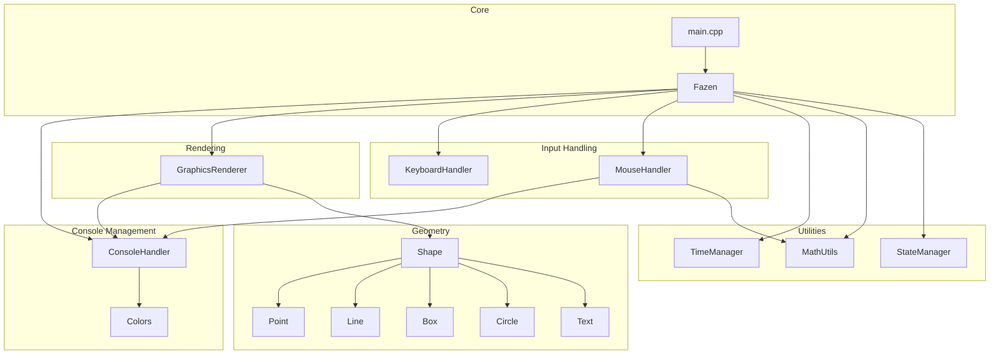
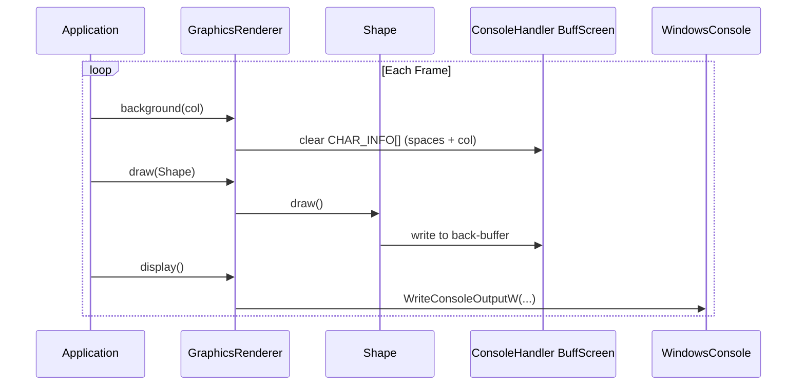
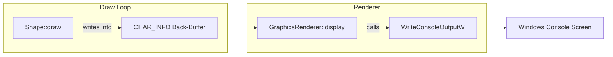
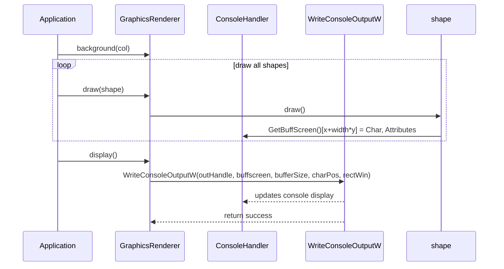
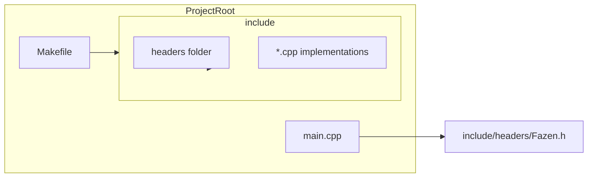
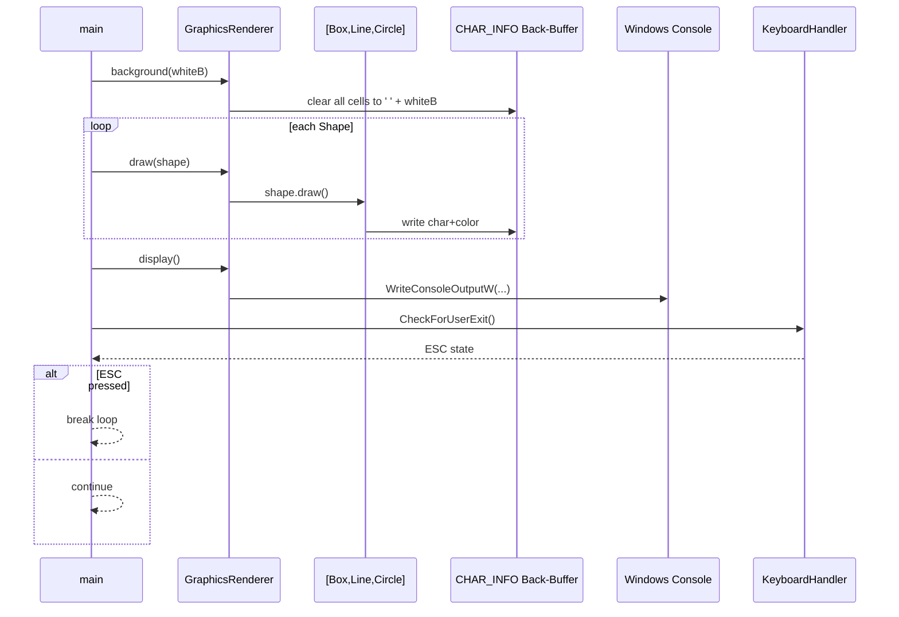

# Fazen2d
# ASCII & UNICODE Graphics Library made for and using C++ Windows 

# Fazen2d Engine Documentation

## Overview

Fazen2d is a lightweight ASCII & Unicode graphics library for Windows consoles. It provides basic **geometry primitives**, **console rendering**, **input handling**, **state management**, and **timing services**. Users can draw shapes (points, lines, boxes, circles, text), handle keyboard and mouse events, and run a continuous render loop in a structured framework.

This engine fits into applications that require simple graphical output without external libraries beyond the Windows API. It centralizes console setup, buffer management, and coordinate transformations to simplify 2D console graphics development.

## Architecture Overview



## Component Structure

### Geometry Module

#### Shape (`include/headers/Shape.h`)
The **Shape** class defines a common interface for all drawable primitives. It enforces:
- A **pure virtual** `draw()` method.
- A **pure virtual** `translate(float dx, float dy)` method.
- A **virtual destructor** for safe polymorphic cleanup.

```cpp
class Shape {
public:
    virtual void draw() = 0;
    virtual void translate(float dx, float dy) = 0;
    virtual ~Shape() = default;
};
```


#### Point (`include/headers/Point.h` / `include/Point.cpp`)
Represents a single console cell at `(x, y)` with a character and color.
- **Properties**: `x`, `y`, `color`, `character`
- **Key Methods**:
  - `draw()` writes the character into the console buffer.
  - `translate(dx, dy)` moves the point within console bounds.

```cpp
explicit Point(float x, float y, short color, short character = 0x2588);
void draw() override;
void translate(float dx, float dy) override;
```


#### Line (`include/headers/Line.h` / `include/Line.cpp`)
Draws a Bresenham line between two points.
- **Properties**: `x1, y1, x2, y2, color, character`
- **Key Methods**:
  - `draw()` implements Bresenham’s algorithm.
  - `translate(dx, dy)` shifts both endpoints.

```cpp
Line(float x1, float y1, float x2, float y2, short color, short character = 0x2588);
void draw() override;
void translate(float dx, float dy) override;
```


#### Box (`include/headers/Box.h` / `include/Box.cpp`)
Renders a filled rectangle by drawing multiple points.
- **Properties**: `x, y, width, height, color, character`
- **Key Methods**:
  - `draw()` loops over width/height to place points.
  - `translate(dx, dy)` moves the box if within console bounds.

```cpp
explicit Box(float x, float y, float width, float height, short color, short character = 0x2588);
void draw() override;
void translate(float dx, float dy) override;
```


#### Circle (`include/headers/Circle.h` / `include/Circle.cpp`)
Draws a filled circle by checking each cell within a bounding square.
- **Properties**: `xc, yc, radius, color, character`
- **Key Methods**:
  - `draw()` uses the distance formula for each cell.
  - `translate(dx, dy)` shifts center within valid range.

```cpp
explicit Circle(float xc, float yc, float radius, short color, short character = 0x2588);
void draw() override;
void translate(float dx, float dy) override;
```


#### Text (`include/headers/Text.h` / `include/Text.cpp`)
Renders a Unicode string at a given location.
- **Properties**: `x, y, wstring value, color`
- **Key Methods**:
  - `draw()` writes each wide character into the buffer.
  - `setValue` overloads accept `wstring` or `int`.

```cpp
Text(float x, float y, wstring s, short color);
void draw() override;
```


---

### Rendering Module

#### Colors (`include/headers/Colors.h` / `include/Colors.cpp`)
Defines console color constants and a **Color** utility class.
- **Enum** `ConsoleColor` maps to Windows attributes.
- **Class** `Color` holds `fgColor`, `bgColor`, and computes combined `value`.

```cpp
enum ConsoleColor { redF = FOREGROUND_RED, greenF = FOREGROUND_GREEN, /*…*/ };
class Color {
  short fgColor, bgColor, value;
  // setters/getters
};
```


#### GraphicsRenderer (`include/headers/GraphicsRenderer.h` / `include/GraphicsRenderer.cpp`)
Handles console buffer display and draws shapes.
- **Methods**:
  - `background(short col)` clears buffer with a color.
  - `draw(Shape &s)` invokes `s.draw()`.
  - `display()` writes buffer to the console via `WriteConsoleOutputW`.

```cpp
void background(short col);
void draw(Shape& s);
void display();
```


---

### Input Handling

#### KeyboardHandler (`include/headers/KeyboardHandler.h` / `include/KeyboardHandler.cpp`)
Wraps Windows key state functions.
- **Methods**:
  - `IsKeyPressed(int keyCode)`
  - `IsKeyReleased(int keyCode)`
  - `CheckForUserExit()` checks `VK_ESCAPE`.

```cpp
bool IsKeyPressed(int keyCode);
bool CheckForUserExit();
```


#### MouseHandler (`include/headers/MouseHandler.h` / `include/MouseHandler.cpp`)
Tracks mouse position and click states.
- **Properties**: `leftButtonPressed`, `rightButtonPressed`
- **Methods**:
  - `GetMouseX()`, `GetMouseY()` map screen to console coords.
  - `UpdateMouseState()`, `IsLeftMousePressed()`, `IsLeftMouseClicked()`, etc.

```cpp
float GetMouseX();
float GetMouseY();
void UpdateMouseState();
bool IsLeftMouseClicked();
```


---

### State & Timing

#### StateManager (`include/headers/StateManager.h` / `include/StateManager.cpp`)
Maintains a global **center** offset for coordinate translation.
- **Methods**:
  - `saveState()` / `restoreState()` to snapshot/restore center.
  - `setCenter(x, y)`, `translateCoordinates(x&, y&)`.

```cpp
static void setCenter(float x, float y);
static void translateCoordinates(float& x, float& y);
```


#### TimeManager (`include/headers/TimeManager.h` / `include/TimeManager.cpp`)
Measures frame-to-frame elapsed time.
- **Methods**:
  - `Reset()` resets the internal clock.
  - `GetElapsedTime()` returns seconds since last call.

```cpp
void Reset();
float GetElapsedTime();
```


#### MathUtils (`include/headers/MathUtils.h` / `include/MathUtils.cpp`)
Utility for numeric transformations.
- **Constants**: `static constexpr double pi`
- **Methods**:
  - `Map(value, x1, x2, y1, y2)` scales a value linearly between ranges.

```cpp
static float Map(float value, float x1, float x2, float y1, float y2);
```


---

### Console Management

#### ConsoleHandler (`include/headers/ConsoleHandler.h` / `include/ConsoleHandler.cpp`)
Sets up and manages a 2D console buffer.
- **Static Properties**: window handles, buffers, dimensions.
- **Constructor** configures font, buffer size, input modes.
- **Methods** expose buffer pointers, console size, cursor position.

```cpp
ConsoleHandler(int s_width, int s_height);
static CHAR_INFO* GetBuffScreen();
static int GetConsoleWidth();
static int GetConsoleHeight();
```


---

### Core

#### Fazen (`include/headers/Fazen.h` / `include/Fazen.cpp`)
Aggregates all subsystems:
- **Members**: `console`, `graphics`, `keyboardHandler`, `mouseHandler`, `timer`
- **Constructor** initializes `ConsoleHandler`.

```cpp
Fazen(int s_width, int s_height);
```


#### Main (`main.cpp`)
Entry point demonstrating the engine loop:
1. Instantiate `Fazen game(100, 100)`.
2. Clear background, draw shapes, translate them.
3. `game.graphics.display()`, exit on `ESC`.

```cpp
while (true) {
  game.graphics.background(whiteB);
  game.graphics.draw(b);
  // ...
  if (game.keyboardHandler.CheckForUserExit()) break;
}
```


#### Build (`Makefile`)
Compiles all `.cpp` under `include/` and `main.cpp` with `g++ -std=c++11`.
```bash
CC = g++
CFLAGS = -std=c++11
SRC_DIR = include
# ...
all: a
```


## Key Classes Reference

| Class              | Location                                | Responsibility                                     |
|--------------------|-----------------------------------------|----------------------------------------------------|
| Shape              | include/headers/Shape.h                 | Base interface for all drawable shapes             |
| Point              | include/headers/Point.h                 | Represents a single console cell                   |
| Line               | include/headers/Line.h                  | Draws lines using Bresenham’s algorithm            |
| Box                | include/headers/Box.h                   | Renders filled rectangles                          |
| Circle             | include/headers/Circle.h                | Renders filled circles                             |
| Text               | include/headers/Text.h                  | Draws wide-character strings                       |
| Colors / Color     | include/headers/Colors.h                | Defines color constants and utility class          |
| GraphicsRenderer   | include/headers/GraphicsRenderer.h      | Manages buffer clearing and shape rendering        |
| ConsoleHandler     | include/headers/ConsoleHandler.h        | Sets up and provides access to the console buffer  |
| KeyboardHandler    | include/headers/KeyboardHandler.h       | Wraps keyboard state queries                       |
| MouseHandler       | include/headers/MouseHandler.h          | Tracks mouse position and click states             |
| StateManager       | include/headers/StateManager.h          | Global coordinate offset manager                   |
| TimeManager        | include/headers/TimeManager.h           | Frame timing calculations                          |
| MathUtils          | include/headers/MathUtils.h             | Numeric mapping and constants                      |
| Fazen              | include/headers/Fazen.h                 | Aggregates all subsystems into one engine object   |
| Main               | main.cpp                                | Demonstrates engine initialization and loop        |
| Build              | Makefile                                | Compilation instructions                           |


# Core Usage Patterns: The Frame Loop

## Overview

The frame loop in Fazen2d embodies the classic clear–draw–display cycle, enabling smooth, flicker-free rendering in the Windows console. Each iteration clears the off-screen buffer to a uniform background, issues draw commands for all visible shapes, and then flushes the completed buffer to the console in one atomic operation. This double-buffering strategy decouples per-cell updates from on-screen presentation, ensuring consistent frame timing and a tear-free visual experience.

By centralizing buffer management and draw dispatch in the `GraphicsRenderer` class, application code remains focused on high-level scene composition. Whether you’re animating geometry primitives or outputting text, the same three-step loop applies, making day-to-day use of the library both intuitive and efficient.

## Frame Loop Workflow

1. **Clear (Background)**

Call `GraphicsRenderer::background(col)` to fill the entire back-buffer with spaces and a uniform color attribute.

1. **Draw**

For each shape or text object, invoke `GraphicsRenderer::draw(shape)`, which in turn calls the shape’s own `draw()` method to write characters into the back-buffer.

1. **Display**

Flush the back-buffer to the visible console window via `GraphicsRenderer::display()`, which wraps the Win32 `WriteConsoleOutputW` API.

```mermaid
flowchart LR
    A[Application] --> B[GraphicsRenderer background]
    B --> C[ConsoleHandler BuffScreen]
    A --> D[GraphicsRenderer draw(Shape)]
    D --> E[Shape draw]
    E --> C
    A --> F[GraphicsRenderer display]
    F --> G[WriteConsoleOutputW]
    G --> H[Windows Console]
```

## Component Structure

### GraphicsRenderer

*Path:* `include/headers/GraphicsRenderer.h` / `include/GraphicsRenderer.cpp`

Manages the off-screen buffer lifecycle and delegates draw calls to shapes.

| Method | Description |
| --- | --- |
| display() | Flushes the back-buffer to the console via `WriteConsoleOutputW` . |
| background(short col) | Iterates over every cell in `ConsoleHandler::GetBuffScreen()` to set a space character and the given attribute . |
| draw(Shape &s) | Invokes `s.draw()`, allowing each shape to write into the back-buffer . |


### ConsoleHandler (Back-Buffer Access)

*Path:* `include/headers/ConsoleHandler.h` / `include/ConsoleHandler.cpp`

Initializes and configures the console buffer; exposes low-level back-buffer pointers and dimensions.

| API | Description |
| --- | --- |
| GetBuffScreen() | Returns a pointer to the `CHAR_INFO[]` back-buffer . |
| GetBufferSize() | Returns a `COORD` struct with buffer width and height . |
| GetCharacterPos() | Returns the buffer origin coordinate for `WriteConsoleOutputW` . |
| GetRectWin() | Returns the `SMALL_RECT*` describing the console window region . |


## How It Works Under the Hood

When you call `GraphicsRenderer::display()`, Fazen2d invokes:

```cpp
WriteConsoleOutputW(
    ConsoleHandler::GetOutHandle(),
    ConsoleHandler::GetBuffScreen(),
    ConsoleHandler::GetBufferSize(),
    ConsoleHandler::GetCharacterPos(),
    ConsoleHandler::GetRectWin()
);
```

This single API call atomically swaps the entire back-buffer into the visible console, eliminating partial updates and visual tearing .

## Example Usage

The following snippet, adapted from **main.cpp**, illustrates a minimal animation loop:

```cpp
Fazen game(100, 100);
Box    b(0, 20, 20, 60, redF);
Line   l(0, 0, 10, 10, blueF);
Circle c(20, 20, 10, greenF);

while (true) {
    game.graphics.background(whiteB);
    game.graphics.draw(b);
    game.graphics.draw(l);
    game.graphics.draw(c);

    // Simple movement
    b.translate(0.01f, 0.01f);
    l.translate(0.1f,  0.1f);
    c.translate(0.1f,  0.1f);

    game.graphics.display();

    if (game.keyboardHandler.CheckForUserExit()) {
        break;
    }
}
```

## Frame Loop Sequence



## Key Classes Reference

| Class | Path | Responsibility |
| --- | --- | --- |
| GraphicsRenderer | `include/headers/GraphicsRenderer.h` | Orchestrates back-buffer clearing, shape rendering, and buffer flush |
| ConsoleHandler | `include/headers/ConsoleHandler.h` | Sets up console buffer and provides back-buffer access |
| Shape | `include/headers/Shape.h` | Base interface for all drawable primitives |
| Fazen | `include/headers/Fazen.h` | Aggregates subsystems (console, graphics, input, timing, state) |

# Core Usage Patterns – Colors and Characters: Styling Your Output

## Overview

Styling in Fazen2d is driven by Windows console attributes, allowing you to tint shapes and text with foreground and background colors. The built-in `ConsoleColor` enum provides common color masks, while the `Color` utility class makes it easy to compose custom combinations. Use `GraphicsRenderer::background` to clear the back buffer to a uniform color before drawing your primitives.

## ConsoleColor Enum

Defined in **include/headers/Colors.h**, `ConsoleColor` maps human-readable names to Windows attribute masks :

Constant | Definition

---|---

redF | `FOREGROUND_RED | FOREGROUND_INTENSITY`

redB | `BACKGROUND_RED | BACKGROUND_INTENSITY`

blueF | `FOREGROUND_BLUE | FOREGROUND_INTENSITY`

blueB | `BACKGROUND_BLUE | BACKGROUND_INTENSITY`

greenF | `FOREGROUND_GREEN | FOREGROUND_INTENSITY`

greenB | `BACKGROUND_GREEN | BACKGROUND_INTENSITY`

dmagentaF | `0x0005`

magentaF | `0x000D`

yellowF | `0x000E`

dyellowF | `0x0006`

dredF | `0x0004`

greyF | `0x0008`

dgreenF | `0x0002`

whiteF | `0x000F`

whiteB | `BACKGROUND_BLUE | BACKGROUND_RED | BACKGROUND_GREEN | BACKGROUND_INTENSITY`

## Color Utility Class

The **Color** class (in **include/headers/Colors.h** / **include/Colors.cpp**) encapsulates a foreground mask, background mask, and their bitwise OR value :

Property | Type | Description

---|---|---

`fgColor` | `short` | Foreground attribute mask

`bgColor` | `short` | Background attribute mask

`value` | `short` | Combined `fgColor | bgColor`

Method | Description

---|---

`Color(short fgColor=0, short bgColor=whiteB)` | Initialize masks and compute `value`

`setFgColor(short)` | Change foreground mask

`setBgColor(short)` | Change background mask

`setValue(short)` | Override combined value directly

`getFgColor()` | Retrieve foreground mask

`getBgColor()` | Retrieve background mask

`getValue()` | Retrieve combined attribute

## Applying Colors to Primitives

Every shape and text primitive accepts a `short color` parameter, which is written into each `CHAR_INFO.Attributes` cell during `draw()`:

- **Point**

```cpp
  ConsoleHandler::GetBuffScreen()[x + width * y].Attributes = color;
```

- **Text**

```cpp
  ConsoleHandler::GetBuffScreen()[pos].Attributes = color;
```

- **Box** and **Circle** internally create `Point` instances, inheriting its color behavior.

## Clearing Background with Color

`GraphicsRenderer::background(short col)` fills the entire back buffer with space characters at the given attribute, effectively painting the background :

```cpp
void GraphicsRenderer::background(short col){
    int total = ConsoleHandler::GetConsoleHeight() * ConsoleHandler::GetConsoleWidth();
    for (int i = 0; i < total; i++){
        ConsoleHandler::GetBuffScreen()[i].Char.UnicodeChar = ' ';
        ConsoleHandler::GetBuffScreen()[i].Attributes   = col;
    }
}
```

## Example Usage

```cpp
#include "headers/Fazen.h"
#include "headers/Colors.h"
#include "headers/Box.h"
#include "headers/Line.h"
#include "headers/Circle.h"
#include "headers/Text.h"

Fazen game(100, 100);

// 1. Clear to white background
game.graphics.background(whiteB);

// 2. Create primitives with styled colors
Box    b(0,  20,  20, 60, redF);
Line   l(0,   0,  10, 10, blueF);
Circle c(20, 20,  10, greenF);
Text   t(5,   5, L"Hello, Fazen!", magentaF);

// 3. Render loop
while (true) {
    game.graphics.background(whiteB);
    game.graphics.draw(b);
    game.graphics.draw(l);
    game.graphics.draw(c);
    game.graphics.draw(t);
    game.graphics.display();

    if (game.keyboardHandler.CheckForUserExit())
        break;
}
```

This pattern allows you to rapidly prototype styled console graphics by mixing preset `ConsoleColor` values or composing your own with the `Color` utility.

# Internals (For Advanced Users Only) - How Rendering Works Under the Hood

## Overview

The internal rendering pipeline of Fazen2d manages all drawing operations through a back-buffer in system memory (a `CHAR_INFO*` array) and flushes it to the Windows console using the Win32 API call `WriteConsoleOutputW`. This approach decouples shape rasterization from the slow console cursor operations and enables flicker-free, high-performance updates.

Advanced users can leverage this knowledge to implement custom drawing primitives, debugging tools, or integrate Fazen2d’s buffer directly into other console-based systems.

## Internal Architecture Overview



- **Shape::draw** implementations (Point, Line, Box, Circle, Text) write characters and attributes directly into the back-buffer.
- **GraphicsRenderer::display** retrieves buffer pointers and console parameters, then invokes `WriteConsoleOutputW`.
- The Windows console API updates the visible screen in a single, atomic operation.

## Component Structure

### ConsoleHandler Buffer Management

*include/headers/ConsoleHandler.h*

*include/ConsoleHandler.cpp*

ConsoleHandler centralizes console setup and provides static access to all parameters required for rendering.

#### Properties

| Property | Type | Description |
| --- | --- | --- |
| `static CHAR_INFO *buffscreen` | CHAR_INFO* | Back-buffer array of size `console_width * console_height`. |
| `static HANDLE outhnd` | HANDLE | Output handle for the console (`STD_OUTPUT_HANDLE`). |
| `static HANDLE inhnd` | HANDLE | Input handle for mouse/keyboard (`STD_INPUT_HANDLE`). |
| `static COORD buffersize` | COORD | Dimensions of the back-buffer (`{console_width, console_height}`). |
| `static COORD characterPos` | COORD | Upper-left coordinates within the buffer for flush origin. |
| `static SMALL_RECT rect_win` | SMALL_RECT | Destination rectangle on screen (`{0,0, width-1, height-1}`). |
| `static int console_width` | int | Width of the console in cells. |
| `static int console_height` | int | Height of the console in cells. |
| `static int fontW`, `fontH` | int | Font cell dimensions in pixels. |
| `static int consoleRangeStartx, consoleRangeStarty` | int | Top-left pixel of console window on desktop (for mouse mapping). |


#### Key Methods

| Method | Description |
| --- | --- |
| `ConsoleHandler(int s_width,int s_height)` | Allocates `buffscreen`, initializes handles and console sizes, sets font and buffer. |
| `void make2DConsole(int fontw,int fonth)` | Configures console font metrics and screen buffer mode. |
| `static CHAR_INFO* GetBuffScreen()` | Returns pointer to the back-buffer. |
| `static HANDLE GetOutHandle()` | Returns the output handle for `WriteConsoleOutputW`. |
| `static COORD GetBufferSize()` | Returns `{console_width, console_height}`. |
| `static COORD GetCharacterPos()` | Returns `{0,0}` (write origin within buffer). |
| `static SMALL_RECT* GetRectWin()` | Returns pointer to `{0,0, width-1, height-1}` rectangle. |


### GraphicsRenderer Output Pipeline

*include/headers/GraphicsRenderer.h*

*include/GraphicsRenderer.cpp*

GraphicsRenderer orchestrates buffer clearing and flushing.

#### Methods

| Method | Description |
| --- | --- |
| `void background(short col)` | Fills every `CHAR_INFO` in `buffscreen` with space and the given attribute (`col`). |
| `void draw(Shape& s)` | Invokes `s.draw()`, causing the shape to rasterize itself into `buffscreen`. |
| `void display()` | Calls `WriteConsoleOutputW` with parameters from `ConsoleHandler` to flush the entire back-buffer. |


```cpp
void GraphicsRenderer::display(){
    WriteConsoleOutputW(
        ConsoleHandler::GetOutHandle(),
        ConsoleHandler::GetBuffScreen(),
        ConsoleHandler::GetBufferSize(),
        ConsoleHandler::GetCharacterPos(),
        ConsoleHandler::GetRectWin()
    );
}
```

### Buffer Indexing Model

All rasterization writes target the single-dimensional `CHAR_INFO* buffscreen` array. The cell at console coordinates `(x, y)` maps to:

```plaintext
index = x + (width * y)
buffscreen[index]
```

- `width` is `ConsoleHandler::GetConsoleWidth()`.
- Each `CHAR_INFO` holds a `UnicodeChar` and `Attributes` field.

This linear indexing enables O(1) writes per cell.

## Rendering Sequence Diagram



## Key Classes Reference

| Class | Location | Responsibility |
| --- | --- | --- |
| ConsoleHandler | include/headers/ConsoleHandler.h | Manages console setup, parameters, and provides the back-buffer. |
| GraphicsRenderer | include/headers/GraphicsRenderer.h | Clears, accumulates, and flushes the back-buffer via Win32 API call. |
| Shape | include/headers/Shape.h | Abstract interface for drawable objects that write into `buffscreen`. |

# Internals (For Advanced Users Only)

## Project Layout and Source Organization

The Fazen2d repository is organized into three top-level artifacts:

- **include/**- Houses both the **interface headers** (in `include/headers/`) and the **implementation units** (`*.cpp`) directly under `include/`.
- **main.cpp**- A demonstration/entry-point that instantiates the engine, runs the render loop, and handles exit.
- **Makefile**- Drives compilation: all `.cpp` under `include/` plus `main.cpp` are compiled and linked into the final executable.

```text
.
├── include
│   ├── headers
│   │   ├── Box.h
│   │   ├── Circle.h
│   │   ├── Colors.h
│   │   ├── ConsoleHandler.h
│   │   ├── Fazen.h
│   │   ├── GraphicsRenderer.h
│   │   ├── KeyboardHandler.h
│   │   ├── Line.h
│   │   ├── MathUtils.h
│   │   ├── MouseHandler.h
│   │   ├── Point.h
│   │   ├── Shape.h
│   │   ├── StateManager.h
│   │   └── TimeManager.h
│   ├── Box.cpp
│   ├── Circle.cpp
│   ├── Colors.cpp
│   ├── ConsoleHandler.cpp
│   ├── Fazen.cpp
│   ├── GraphicsRenderer.cpp
│   ├── KeyboardHandler.cpp
│   ├── Line.cpp
│   ├── MathUtils.cpp
│   ├── MouseHandler.cpp
│   ├── Point.cpp
│   ├── StateManager.cpp
│   └── TimeManager.cpp
├── main.cpp
└── Makefile
```

---

## Interface vs Implementation

### `include/headers/` (Interface)

- Contains **all public headers** (`*.h`).
- Declares classes, pure‐virtual interfaces (e.g. `Shape`), structs, enums, and inline constants (e.g. `MathUtils::pi`, `ConsoleColor`).
- **No** method bodies (except inline or `constexpr`).

### `include/` (Implementation)

- Holds **one **`**.cpp**`** per subsystem**, paired by name with its header in `include/headers/`.
- Each `.cpp` includes its corresponding header via:

```cpp
  #include "headers/GraphicsRenderer.h"
```

- Implements constructors, method bodies, and private/static state.

---

## Header Inclusion Guidelines

- **User code** (e.g. `main.cpp`) typically includes the aggregation header:

```cpp
  #include "include/headers/Fazen.h"
```

- **Implementation units** under `include/` include headers with the `headers/` prefix, because `SRC_DIR = include` in the Makefile:

```cpp
  #include "headers/ConsoleHandler.h"
```

- To write extension code:1. Place new interface in `include/headers/YourFeature.h`.
2. Place corresponding implementation in `include/YourFeature.cpp`.
3. Reference your new header from other `.cpp` or from `Fazen.h` as needed.

---

## Aggregation via Fazen.h

The `include/headers/Fazen.h` file serves as a **convenience umbrella**. It pulls in every major subsystem’s header so user code can write:

```cpp
#include "include/headers/Fazen.h"

int main() {
    Fazen engine(80, 25);
    // ...
}
```

Its contents:

```cpp
#ifndef FAZEN_H
#define FAZEN_H

#include <windows.h>

#include "StateManager.h"
#include "ConsoleHandler.h"
#include "MathUtils.h"
#include "Colors.h"
#include "MouseHandler.h"
#include "KeyboardHandler.h"
#include "GraphicsRenderer.h"
#include "TimeManager.h"

#include "Circle.h"
#include "Point.h"
#include "Line.h"
#include "Text.h"
#include "Box.h"

class Fazen {
public:
    ConsoleHandler console;
    GraphicsRenderer graphics;
    KeyboardHandler keyboardHandler;
    TimeManager timer;
    MouseHandler mouseHandler;

    Fazen(int s_width, int s_height);
};

#endif
```

---

## Build Process (Makefile)

The provided Makefile compiles every implementation unit and links them into a single executable `a`:

```make
CC = g++
CFLAGS = -std=c++11

SRC_DIR = include
OBJ_DIR = include

SRC_FILES = $(wildcard $(SRC_DIR)/*.cpp) main.cpp
OBJ_FILES = $(patsubst $(SRC_DIR)/%.cpp,$(OBJ_DIR)/%.o,$(SRC_FILES))

TARGET = a

all: $(TARGET)

$(TARGET): $(OBJ_FILES)
    $(CC) $(CFLAGS) $^ -o $@

$(OBJ_DIR)/%.o: $(SRC_DIR)/%.cpp
    $(CC) $(CFLAGS) -c $< -o $@

clean:
    del /Q $(OBJ_DIR)\*.o
```

- **Compilation**- Pattern rule compiles each `include/Name.cpp` into `include/Name.o`.
- `main.cpp` compiles via the wildcard rule into `include/main.o` (as part of `SRC_FILES`).
- **Linking**- All `.o` files (in `include/`) are linked to produce the executable `a`.
- **Header Search Path**- By default, the compiler sees `include/` as source root; headers are included either as `headers/...` (from `.cpp`) or relative paths in user code.

---

## File‐Tree Visualization



---

## Summary

Advanced users extending or embedding Fazen2d should:

- **Treat **`**include/headers/**` as the public API surface.
- **Place implementations** in `include/` alongside existing `.cpp` files.
- **Leverage** the umbrella header `Fazen.h` for convenience or include individual headers for finer control.
- **Understand** that the Makefile automates compilation of all `.cpp` under `include/`, linking them into a single binary.

# Getting Started (Build, Run, First Output) – Run the Demo (main.cpp Render Loop)

## Overview

This section guides you through building the Fazen2d demo, running the resulting executable, and understanding the render loop in **main.cpp**. You will compile the engine using the provided Makefile, launch the demo to see an animated Box, Line, and Circle moving across the console, and learn how the console buffer is cleared, drawn to, and flushed each frame. Pressing **ESC** exits the demo.

## Prerequisites

- Windows 10 or later with Console API support
- A C++11-capable compiler (e.g., g++ from MinGW or Visual C++)
- Make utility (for the provided Makefile)

## 1. Build

Fazen2d uses a simple Makefile at the repository root:

```bash
# Compiler and flags
CC = g++
CFLAGS = -std=c++11

# Directories
SRC_DIR = include
OBJ_DIR = include

# Source and object files
SRC_FILES = $(wildcard $(SRC_DIR)/*.cpp) main.cpp
OBJ_FILES = $(patsubst $(SRC_DIR)/%.cpp,$(OBJ_DIR)/%.o,$(SRC_FILES))

# Executable name
TARGET = a

all: $(TARGET)

$(TARGET): $(OBJ_FILES)
	$(CC) $(CFLAGS) $^ -o $@

$(OBJ_DIR)/%.o: $(SRC_DIR)/%.cpp
	$(CC) $(CFLAGS) -c $< -o $@

clean:
	del /Q $(OBJ_DIR)\*.o
```

Run `make` in the project root to produce the executable `a` .

## 2. Run the Demo

In a Windows console, execute:

```plaintext
.\a
```

You will see a white background with a red Box, blue Line, and green Circle animating diagonally. Press **ESC** to exit.

## 3. main.cpp Render Loop

The entry point **main.cpp** initializes the engine and enters a continuous render loop:

```cpp
#include "include/headers/Fazen.h"

int main(){
    Fazen game(100,100);
    game.graphics.background(whiteB);

    Box b(0,20,20,60,redF);
    Line l(0,0,10,10,blueF);
    Circle c(20,20,10,greenF);

    while(true){
        // 1. Clear background each frame
        game.graphics.background(whiteB);

        // 2. Draw shapes into buffer
        game.graphics.draw(b);
        game.graphics.draw(l);
        game.graphics.draw(c);

        // 3. Move shapes slightly
        b.translate(0.01,0.01);
        l.translate(0.1,0.1);
        c.translate(0.1,0.1);

        // 4. Flush buffer to console
        game.graphics.display();

        // 5. Exit on ESC key
        if(game.keyboardHandler.CheckForUserExit()){
            break;
        }
    }
}
```

– **Initialization**: `Fazen game(100,100)` sets up a 100×100 console buffer and font .

– **Background**: `background(whiteB)` fills every cell with a space character and the combined background color `whiteB` .

– **Drawing**: `draw(s)` invokes each shape’s `draw()` to write into the `CHAR_INFO` back‐buffer.

– **Display**: `display()` calls `WriteConsoleOutputW` to copy the back‐buffer to the screen .

– **Input**: `CheckForUserExit()` checks `VK_ESCAPE` via `GetAsyncKeyState` and returns non‐zero when ESC is pressed .

## 4. Render Loop Sequence



## 5. Expected Output

On running, the console shows:

- A white background filling the entire window.
- A red rectangle (Box) moving diagonally.
- A blue diagonal line moving faster.
- A green filled circle moving across.

The animation continues until ESC is pressed.

---

This walkthrough covers building the demo, running it, and understanding the continuous render loop in **main.cpp**, including buffer management, drawing, and exit handling.

## Getting Started (Build, Run, First Output)

### System Requirements & Compatibility

- **Operating System**: Windows (console-only). Fazen2d relies on native Windows Console APIs via `<windows.h>` in modules like ConsoleHandler.cpp .
- **Compiler**: A C++ compiler with C++11 support. The default build uses `g++ -std=c++11` .
- **Toolchain**: Any Windows port of GCC works (e.g., MinGW, MSYS2). Ensure your environment provides `make` (or `mingw32-make`) and `g++`.
- **Console**: A standard Windows console window (cmd.exe or equivalent) with Unicode font support.

### Build

1. Open a developer shell where `make` and `g++` are in your PATH.
2. From the project root, run:

```bash
   make
```

This invokes:

```bash
   g++ -std=c++11 include/*.cpp main.cpp -o a.exe
```

as specified in the Makefile .

1. On success, an executable named `a.exe` appears in the project directory.

### Run

Simply launch the built executable:

```bash
./a.exe
```

or on Windows:

```cmd
a.exe
```

The program enters its render loop and will continue until you press the **Esc** key.

### First Output

Upon running, Fazen2d initializes a back-buffer at the specified console dimensions and clears it to a white background. It then repeatedly:

1. Draws a red filled rectangle (Box).
2. Renders a blue diagonal line (Line).
3. Renders a green filled circle (Circle).
4. Flushes the buffer to the console with `GraphicsRenderer::display()` .

Each frame the shapes translate slightly, producing simple animation. Pressing **Esc** triggers `KeyboardHandler::CheckForUserExit()` to break the loop and exit .


# Getting Started (Build, Run, First Output)

This guide walks you through building the Fazen2d engine, running the demo, and writing your first minimal program using Fazen. You will see how to:

- Compile the engine and main loop
- Launch the console application
- Initialize the engine, clear the screen, draw shapes, and handle exit

---

## 1. Build

### 1.1 Prerequisites

- Windows 10 or later
- C++ compiler with C++11 support (e.g., MinGW-g++, MSVC)
- [Optional] GNU Make

### 1.2 Using the Makefile

1. Open a Command Prompt in the project root.
2. Run:

```bash
   make
```

1. This compiles all `.cpp` files under `include/` and `main.cpp` with `-std=c++11`, producing the executable `a`.
2. To clean object files:

```bash
   make clean
```

### 1.3 Manual Compilation

If you don’t have Make:

```bash
g++ -std=c++11 include/*.cpp main.cpp -o Fazen2d.exe
```

---

## 2. Run

1. In the same console window, launch the executable:

```bash
   ./a       # or Fazen2d.exe
```

1. A new console buffer of the specified size (see Fazen constructor) opens.
2. The render loop will begin, drawing and updating shapes each frame.

Press ESC to exit the loop and close the program.

---

## 3. First Output

When you run the demo (main.cpp), you should see:

- A white background (`whiteB`) cleared each frame
- A filled red box, a blue line, and a green circle moving across the console
- Smooth updates via `WriteConsoleOutputW` (GraphicsRenderer::display)


Press ESC at any time to terminate.

---

## 4. Your First Program Using Fazen (Minimal Template)

Below is the minimal structure every Fazen application follows. It mirrors **main.cpp** but strips out extras for clarity.

```cpp
#include "include/headers/Fazen.h"            // Fazen engine core
#include "include/headers/Colors.h"           // Predefined ConsoleColor values
#include "include/headers/Box.h"              // Shape primitives
#include "include/headers/Line.h"
#include "include/headers/Circle.h"

int main() {
    // 1. Initialize engine & console buffer (ConsoleHandler via Fazen)
    Fazen game(80, 40);                      // width=80, height=40

    // 2. Initial background fill (GraphicsRenderer::background)
    game.graphics.background(whiteB);

    // 3. Create some shapes
    Box     box   (10,  5, 20, 10, redF);     // x, y, w, h, color
    Line    line  (0,   0, 79, 39, blueF);    // x1,y1,x2,y2,color
    Circle  circle(40, 20, 15, greenF);       // centerX, centerY, radius, color

    // 4. Main render loop
    while (!game.keyboardHandler.CheckForUserExit()) {
        // a) Clear screen
        game.graphics.background(whiteB);

        // b) Draw each shape (GraphicsRenderer::draw)
        game.graphics.draw(box);
        game.graphics.draw(line);
        game.graphics.draw(circle);

        // c) Flush to console (GraphicsRenderer::display)
        game.graphics.display();

        // d) Update shape positions
        box.translate   ( 0.1f,  0.0f);
        line.translate  ( 0.0f,  0.1f);
        circle.translate(-0.05f, 0.05f);
    }

    return 0;
}
```

### How It Works

1. **Fazen constructor** (Fazen.h / Fazen.cpp)- Initializes `ConsoleHandler console;` with your chosen buffer width/height.
2. **Background fill** (`GraphicsRenderer::background`)- Clears the `CHAR_INFO` back-buffer to spaces with the specified attribute (`whiteB`)  .
3. **Drawing shapes** (`GraphicsRenderer::draw`)- Calls each shape’s `draw()` override (Box, Line, Circle), which in turn writes to the back-buffer  .
4. **Display** (`GraphicsRenderer::display`)- Flushes the back-buffer to the console via `WriteConsoleOutputW`  .
5. **Input handling** (`KeyboardHandler::CheckForUserExit`)- Checks `GetAsyncKeyState(VK_ESCAPE)` each frame to break out of the loop  .

---

## 5. Core References

- **Fazen** (`include/headers/Fazen.h` / `include/Fazen.cpp`)

Aggregates all subsystems: `console`, `graphics`, `keyboardHandler`, `mouseHandler`, `timer`.

- **GraphicsRenderer** (`include/headers/GraphicsRenderer.h` / `include/GraphicsRenderer.cpp`)- `background(short col)`
- `draw(Shape& s)`
- `display()`
- **Shape Primitives** (`include/headers/Box.h`, `Line.h`, `Circle.h`, …)

Each implements `draw()` and `translate(dx,dy)`.

- **KeyboardHandler** (`include/headers/KeyboardHandler.h` / `.cpp`)- `bool CheckForUserExit()`

With these building blocks, you can rapidly prototype 2D console visuals using Fazen.

## Getting Started (Build, Run, First Output)

### Build Instructions (Makefile)

Fazen2d ships with a simple Makefile in the project root that automates compilation of the demo. It requires a Windows environment with GNU Make and the `g++` compiler (C++11 support). All source files under `include/` plus `main.cpp` are compiled into a single executable named `a`, and intermediate object files are stored alongside source files.

#### Prerequisites

- Windows OS (cmd.exe, PowerShell, Git Bash, or similar)
- GNU Make installed and available on your PATH
- g++ compiler (e.g., via MinGW) with support for C++11

#### Makefile Overview

```make
# Compiler and compiler flags
CC = g++
CFLAGS = -std=c++11

# Directories
SRC_DIR = include
OBJ_DIR = include

# Source files and object files
SRC_FILES = $(wildcard $(SRC_DIR)/*.cpp) main.cpp
OBJ_FILES = $(patsubst $(SRC_DIR)/%.cpp,$(OBJ_DIR)/%.o,$(SRC_FILES))

# Executable name
TARGET = a

# Targets
all: $(TARGET)

$(TARGET): $(OBJ_FILES)
	$(CC) $(CFLAGS) $^ -o $@

$(OBJ_DIR)/%.o: $(SRC_DIR)/%.cpp
	$(CC) $(CFLAGS) -c $< -o $@

clean:
	del /Q $(OBJ_DIR)\*.o
```

- **Compiler & Flags**: `CC = g++`, `CFLAGS = -std=c++11`
- **Sources**: `include/*.cpp` and `main.cpp`
- **Objects**: Each `.cpp` in `include/` becomes a corresponding `.o` in `include/`
- **Executable**: Named `a` (via `TARGET = a`)
- **Cleanup**: `make clean` runs `del /Q include\*.o` to remove object files

#### Building the Demo

1. Open a Windows command prompt (or Git Bash) in the repository root.
2. Run:

```plaintext
   make
```

1. On success, an executable `a.exe` (or `a`) will appear in the root directory.

#### Cleaning Build Artifacts

To remove all compiled object files:

```plaintext
make clean
```

This invokes the `clean` target and deletes `include\*.o` files.

#### Common Troubleshooting

- `**make**`** Not Found**: Install GNU Make (e.g., via MinGW or Chocolatey) and ensure it’s on your PATH.
- `**g++**`** Not Found**: Install MinGW or another GCC distribution; add `bin` folder to PATH.
- **Spaces in Path**: Clone or move the project to a path without spaces to avoid Windows command-line parsing issues.
- **Shell Compatibility**: The `del` command is native to CMD; if using PowerShell, ensure aliases aren’t overridden or use Git Bash/WSL.
- **Permission Errors**: Run the shell as Administrator if `del` cannot delete `.o` files.
